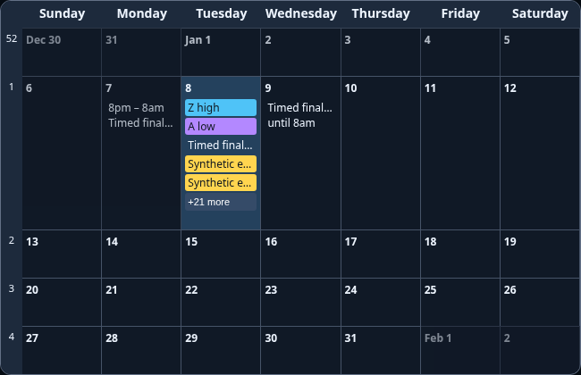
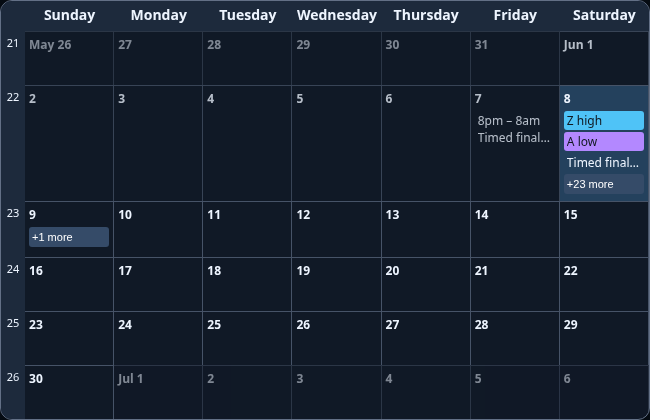

# MMM-AdaptiveMonthlyCalendar

An **upstream-derived community module** for MagicMirror²: a monthly calendar
with configurable event priorities, adaptive week heights and accessible
overflow dialogs. Based on
[MMM-MonthlyCalendar](https://github.com/kolbyjack/MMM-MonthlyCalendar) by
Jonathan Kolb. This is not an official upstream release or an entirely original
calendar implementation. Upstream attribution and MIT notices are preserved.

Version 0.1.0. This community derivative preserves upstream attribution and
adds the features documented below.



## Installation

From your MagicMirror installation:

```sh
cd modules
git clone https://github.com/QuietNodeLab/MMM-AdaptiveMonthlyCalendar.git MMM-AdaptiveMonthlyCalendar
```

No extra
runtime npm dependencies or shared dashboard stylesheet are required. The tested
baseline is MagicMirror 2.38.0 with Node 24 and a modern Chromium browser.

Add the entry from `config.example.js` to your local config's `modules` array.
Supply events separately using MagicMirror's default calendar or a compatible
`CALENDAR_EVENTS` broadcaster. The module itself does not download feeds.

```js
{
  module: "MMM-AdaptiveMonthlyCalendar",
  position: "bottom_bar",
  config: {
    calendarHeight: 520,
    calendarWidth: 1000,
    priorityRules: [{ calendarName: "Community", priority: 0 }]
  }
}
```

In the separate default `calendar` module, set `broadcastPastEvents: true` and
choose a sufficient event limit/horizon for the visible month. Keep personal
feed URLs in ignored local configuration. Historical events belong on their past
dates; expired all-day events are not rendered on the exclusive end date.

The display uses the browser's local timezone. The broadcaster/server and
intended display zone must agree for floating ICS `VALUE=DATE` records. For New
York samples, start Node with `TZ=America/New_York node ./serveronly`; in
PowerShell set `$env:TZ = 'America/New_York'` first. For a development Docker
container set `--env TZ=America/New_York` or Compose
`environment: { TZ: America/New_York }`. Choose the same appropriate IANA zone
on server and browser for other locations. A display setting cannot recover
floating dates already misinterpreted upstream. Do not change a production
device's settings as part of testing this candidate.

## Options

| Option                        | Default        | Meaning                                                                                        |
| ----------------------------- | -------------- | ---------------------------------------------------------------------------------------------- |
| `mode`                        | `currentMonth` | `lastMonth`, `currentMonth`, `nextMonth`, `currentWeek`, `twoWeeks`, `threeWeeks`, `fourWeeks` |
| `firstDayOfWeek`              | `sunday`       | Weekday name, or `today` for rolling views                                                     |
| `calendarHeight`              | `520`          | Requested height in pixels; expands to preserve usable rows/overflow controls                  |
| `calendarWidth`               | `1000`         | Requested width in pixels, capped at the containing region width                               |
| `adaptiveFit`                 | `true`         | Allocate row space by content and create `+more` dialogs                                       |
| `headerHeight`                | `30`           | Header height in pixels, minimum 30                                                            |
| `minRowHeight`                | `54`           | Minimum week height; also bounded by overflow-button requirements                              |
| `overflowHeight`              | `20`           | Overflow-button height, minimum 18                                                             |
| `priorityRules`               | `[]`           | Explicit first-match priority rules; lower numbers display first                               |
| `compactTitleRules`           | `[]`           | Exact-match rules rendering matching timed entries on one compact line                         |
| `wrapTitles`                  | `false`        | Allow longer event text to wrap                                                                |
| `displaySymbol`               | `false`        | Display broadcaster-supplied icons using MagicMirror's icon fonts                              |
| `showWeekNumber`              | `false`        | ISO week number for the first date of each row                                                 |
| `hideCalendars`               | `[]`           | Calendar names to omit                                                                         |
| `hideDuplicateEvents`         | `true`         | Deduplicate matching title/start/end entries                                                   |
| `luminanceThreshold`          | `110`          | Background contrast threshold inherited from upstream                                          |
| `multiDayEndingTimeSeparator` | `" until "`    | Final-day suffix for timed multi-day events                                                    |
| `updateDelay`                 | `100`          | Milliseconds to debounce feed notifications                                                    |

### Priority and compact-title rules

A rule can match `calendarName`, `title`, or `color`, case-insensitively. If
several fields are supplied, all must match. Text and color matches are literal:
no regular expressions, substring guessing, named-person exceptions or color-hue
assumptions.

```js
priorityRules: [
  { calendarName: "Community", priority: 0 },
  { title: "Synthetic workshop", priority: 1 },
  { color: "#4FC3F7", priority: 2 }
],
compactTitleRules: [{ title: "Synthetic workshop" }]
```

The first matching priority rule wins. Unmatched events have priority 1000;
chronological ordering stays stable within equal priorities. There are no
default calendar identities or personal rules. Compact-title rules affect timed
events only.

### Overflow and layout

All-day end dates are exclusive and converted only inside a deep local snapshot;
other modules' shared notification objects remain untouched. Timed events ending
in the morning still appear on their final date. Week rows share extra space
when possible; dense weeks receive more space. Hidden events remain available
through `+more`, which opens a native dialog supporting keyboard focus, Close
and Escape.

Extremely short requested heights are expanded so date labels and overflow
buttons remain usable. Turning adaptive fitting off uses equal rows and
scrollable cells. The module recalculates on resize, font readiness and date
changes. Narrow regions truncate labels; the dialog retains full text. A wide
region is recommended.



## Development

```sh
npm ci --ignore-scripts
npm test
```

The offline suite checks copied notification boundaries, invalid intervals,
calendar-date conversion, priorities, row budgets, ISO weeks and deduplication.
For browser tests, prepare the pinned MagicMirror runtime recorded in
`test-runtime.json`, install its development dependencies and Chromium, and run:

```sh
MM_RUNTIME_PATH=/path/to/isolated/MagicMirror \
MM_BROWSER_EXECUTABLE=/path/to/chromium npm run test:browser
```

`MM_BROWSER_EXECUTABLE` is optional when Playwright's Chromium is installed. In
PowerShell set those environment variables before running npm. Browser tests use
synthetic data and loopback ICS fixtures only. Set `WRITE_SCREENSHOTS=1`
explicitly to regenerate the synthetic documentation images. No weather/private
APIs or device services are contacted. See [VALIDATION.md](VALIDATION.md).

## Attribution and scope

See [UPSTREAM.md](UPSTREAM.md), [LICENSE](LICENSE) and
[LICENSE-UPSTREAM](LICENSE-UPSTREAM). No upstream screenshot, private calendar,
production stylesheet or source-project Git history is included. The old
externally referenced week-number snippet has been replaced with independently
expressed ISO calendar arithmetic and regression tests; the provenance is
documented.
